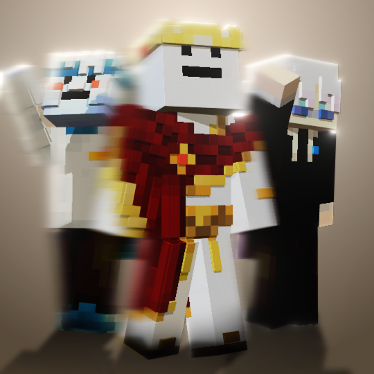

# Combat Blur

**Smooth, adjustable motion blur for Minecraft combat. Created by clierr.**

Combat Blur combines camera motion blur with temporal frame blending for a fluid look, including your first-person hand and held item. Its gentle default keeps the effect subtle, while the strength slider lets you turn it up.

## Features

- **Adjustable strength:** a gentle default of **1.0**, with a range from zero blur to strong motion trails.
- **Hand and item blur:** first-person animations are included by default.
- **Sharp HUD:** your crosshair, hotbar and interface stay clear.
- **Custom settings screen:** compact translucent black panels, a category sidebar, search and bright sand-beige highlights.
- **Detailed controls:** camera rotation and movement, frame persistence, ghost suppression, samples, depth edges and panel opacity.
- **Four mod loaders:** Fabric, Quilt, Forge and NeoForge.
- **OpenGL and Vulkan:** Minecraft's native graphics backend is followed on 26.2 and 26.3.

## Open the settings

Use **`/cb`** or **`/combatblur`**, Mod Menu's config button on Fabric/Quilt, or the Mods config button on Forge/NeoForge.

## Minecraft version groups

Combined JARs are being prepared for these groups:

| Minecraft | Available loader targets |
|---|---|
| **1.21–1.21.4** | Fabric · Quilt · Forge · NeoForge |
| **1.21.4–1.21.11** | Fabric · Quilt · Forge · NeoForge |
| **26.2–26.3** | Fabric · Quilt · Forge · NeoForge |

Use a loader release that exists for your chosen Minecraft version. Each combined JAR selects its matching game adapter. On **1.21.4**, choose one of the overlapping groups.

## Installation

1. Install the mod loader for your Minecraft version.
2. Choose **one** Combat Blur JAR matching your loader and Minecraft group.
3. Place it in the instance's `mods` folder, replacing an older Combat Blur JAR.
4. Fabric and Quilt also need **Fabric API for the same Minecraft version**. Mod Menu is optional.

Use **Java 21** for Minecraft 1.21.x and **Java 25** for 26.x. On 26.2/26.3, choose OpenGL or Vulkan in Minecraft's video settings and restart the game.

## Release status

**Project setup in progress — no public versions have been uploaded yet.**

The combined builds are undergoing compatibility checks. Temporal blending creates a smooth visual effect; it does not generate additional frames or increase FPS. Compatibility with shader packs and other rendering mods has not yet been established.

## Feedback

Report problems through GitHub Issues. Include your Minecraft version, loader version, graphics backend and relevant log details. Remove private information before sharing logs.

**Author:** clierr · **License:** MIT
